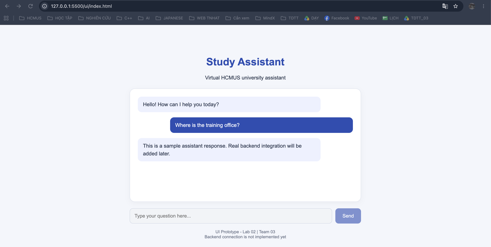

# UI — Study Assistant

This directory contains the user interface documentation and prototypes for the Study Assistant project.

---

# Lab 01 - UI Fundamentals

## 1. Overview

The user interface will live here (Streamlit or Gradio, Week 7 of the practical track).

This directory was intentionally left empty of UI implementation during Lab 01.

## 2. Streamlit

Streamlit is an open-source Python library that allows data scientists, AI/ML engineers, and developers to easily transform Python scripts into interactive web applications without needing to learn or write HTML, CSS, or JavaScript.

## 3. Gradio

Gradio is an open-source Python library that allows you to quickly build interactive web interfaces for Machine Learning models, APIs, or any arbitrary Python function.

## 4. UI and UX Fundamentals

UI/UX stands for User Interface (UI) and User Experience (UX), representing two closely related aspects of designing digital products like websites and apps.

### 4.1. What is UI (User Interface)?

UI is the look, feel, and visual presentation of a product.

- It includes things you can see and touch on a screen.
- Examples are buttons, colors, fonts, spacing, and icons.
- It acts as the visual face of an application.

### 4.2. What is UX (User Experience)?

UX is how a product works and how easy or satisfying it is to use.

- It focuses on the entire journey a user takes.
- It involves research, logic, and problem-solving.
- The goal is to make tasks simple and frustration-free.

### 4.3. How They Work Together

Opinions on Reddit's r/userexperience show that while some separate the two strictly, they function as a team.

You can think of UX as the skeleton and structure of a house, and UI as the paint, furniture, and interior decor.

---

# Lab 02 - Chat UI Placeholder

## 1. Overview

This folder contains the initial user interface prototype
for the Study Assistant project.

The prototype is implemented using HTML and CSS.
It demonstrates the planned chat layout without
requiring a live backend connection.

## 2. Files

- `index.html`: Static chat interface prototype.
- `README.md`: UI design and backend integration plan.
- `../docs/chat-page-placeholder.png`: Screenshot of the UI.

## 3. Current UI Features

The prototype includes:

- Application title and description.
- Sample user and assistant messages.
- A question input field.
- A Send button.
- A responsive layout for different screen sizes.

The input field and Send button are currently disabled
because backend integration has not been implemented.

## 4. Planned Backend Integration

The backend currently provides a Python function:

    reply(message: str) -> str

This function is defined in `src/assistant/rules.py`
and generates a text response based on the user's question.

The planned interaction flow is:

1. The user enters a question in the UI.
2. The user clicks the Send button.
3. The UI passes the question to a Python application layer.
4. The application calls `assistant.reply(message)`.
5. The backend returns a response string.
6. The UI displays the response in the chat area.

Example:

    User input: "hello"
    Backend call: reply("hello")
    UI output: The text returned by the backend.

A future Streamlit or Gradio implementation can connect
the UI to the existing Python backend.

The current HTML prototype does not call the backend.
No API endpoint or HTTP communication is implemented yet.

## 5. How to View the Prototype

1. Open the `ui` folder.
2. Open `index.html` in a web browser.
3. View the sample conversation and input area.

No additional Python packages are required to view
this static HTML prototype.

## 6. Future Improvements

- Enable sending messages.
- Connect the UI to the Python backend.
- Display real responses from the backend.
- Handle empty inputs and unexpected errors.
- Add source citation presentation in Issue #10.

## 7. Screenshot

## 7. Screenshot

The following screenshot demonstrates the Lab 02 chat UI prototype.

## 8. Related Issue

GitHub Issue #9 - UI: chat page placeholder with input box.
